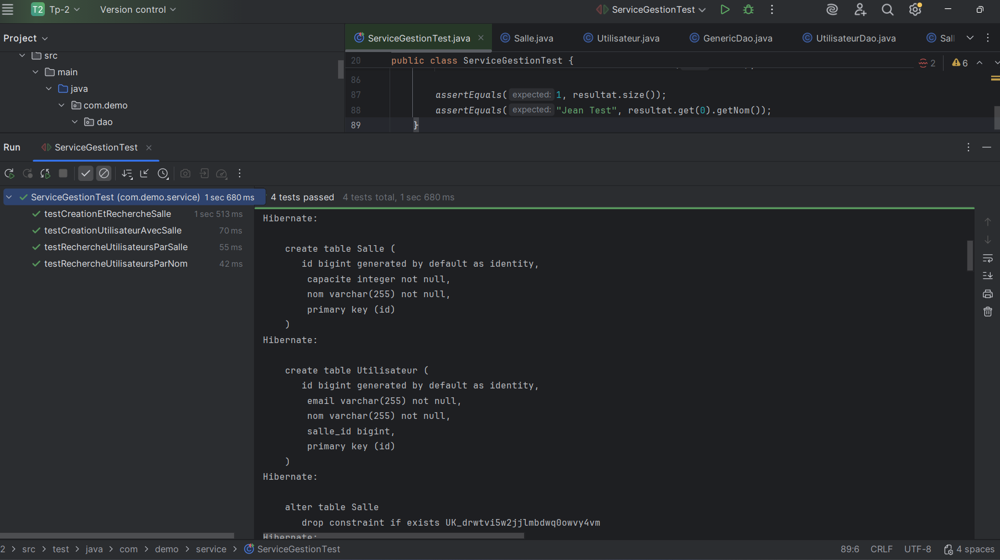
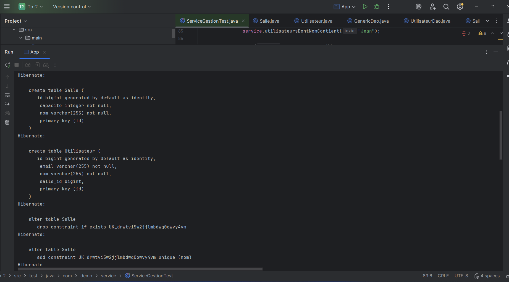
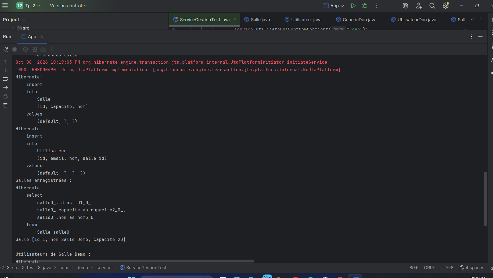
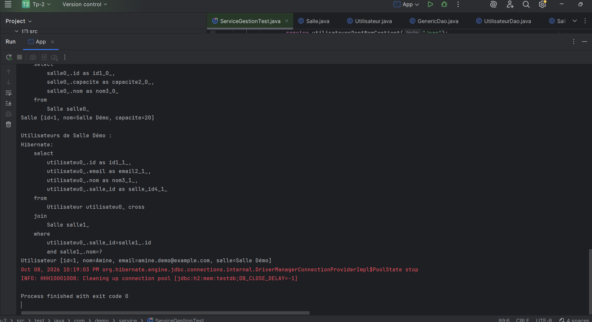

# TP 2 — Gestion des salles et des utilisateurs avec JPA

## Objectif

Ce projet met en pratique la persistance des entités `Salle` et `Utilisateur` avec JPA et Hibernate, sans EJB. Les données sont stockées dans une base H2 en mémoire.

## Technologies

- Java
- Maven
- JPA 2.2 avec Hibernate 5.6
- H2
- JUnit 4

## Fonctionnalités

- Entités `Salle` et `Utilisateur`, avec une relation entre un utilisateur et sa salle.
- `GenericDao<T>` pour les opérations de création, recherche, modification et suppression. Les écritures utilisent des transactions JPA avec validation ou annulation en cas d’erreur.
- `SalleDao` pour rechercher les salles selon leur capacité.
- `UtilisateurDao` pour rechercher les utilisateurs par salle ou par nom.
- `ServiceGestion` pour utiliser les DAO et fermer les ressources JPA.

## Lancer le projet

Dans IntelliJ IDEA, ouvrir le projet Maven à partir de `pom.xml`.

- Pour lancer la démonstration, exécuter la méthode `main` de `com.demo.App`.
- Pour lancer les tests, exécuter `ServiceGestionTest` depuis `src/test/java/com/demo/service`.

La démonstration crée une salle et un utilisateur associé, puis affiche les données retrouvées. La base H2 est en mémoire : les données ne sont pas conservées après l’arrêt du programme.

## Captures des résultats

### 1. Tests JUnit

Les quatre tests JUnit passent, dont la recherche d’utilisateurs par nom.

### 2. Création des tables

Hibernate crée les tables `Salle` et `Utilisateur` dans la base H2.

### 3. Insertion et affichage de la salle

L’application enregistre une salle, puis l’affiche après l’avoir relue depuis la base.

### 4. Recherche de l’utilisateur et fin de l’exécution

L’application retrouve l’utilisateur associé à « Salle Démo » et se termine avec le code de sortie 0.

